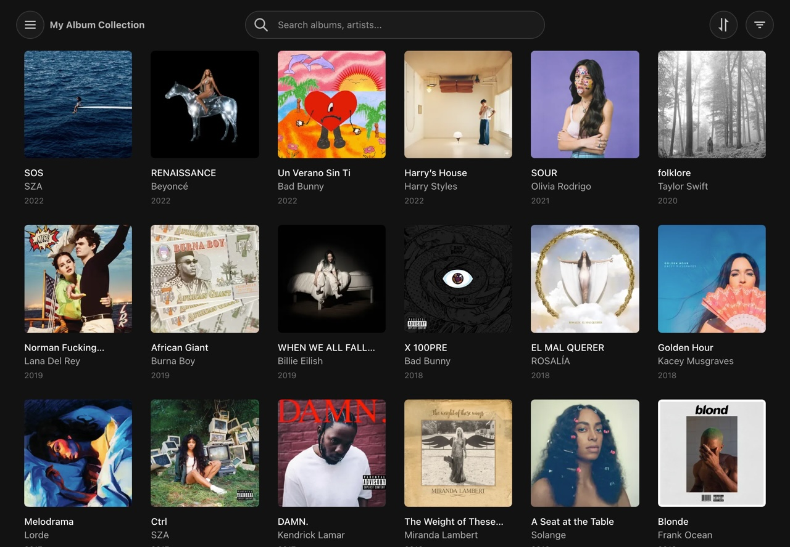
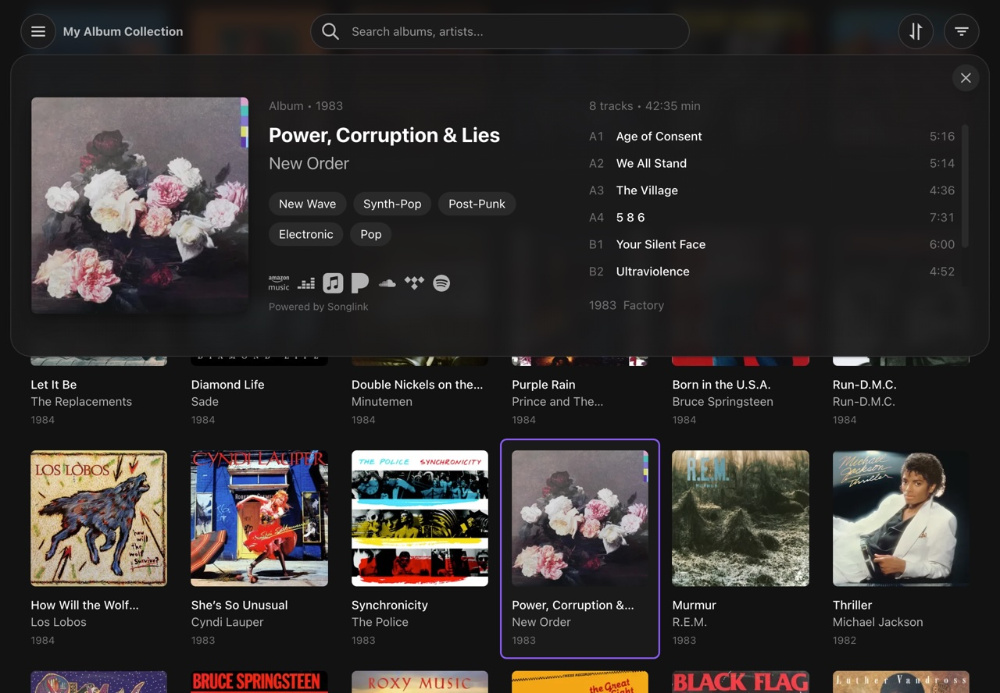
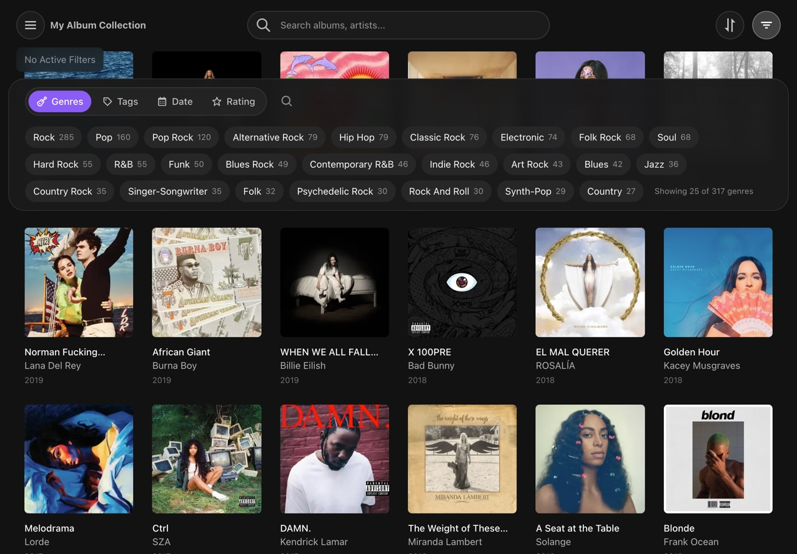

# collection-browser-for-musicbrainz

Next.js-powered collection browser with advanced filtering and streaming integration for MusicBrainz

## Demo

[](https://youtu.be/U05FlKF24Tc)

▶️ [Watch the demo on YouTube](https://youtu.be/U05FlKF24Tc)

## Features

- Browse MusicBrainz release-group collections and series (e.g., "Rolling Stone 500")
- Advanced filtering by genres, tags, labels, dates, and ratings with AND/OR logic
- Streaming service links from MusicBrainz and by barcode (Spotify, Apple Music, Deezer, Tidal, Bandcamp, and more)
- Optional OAuth for personal collection access
- Modern design with dark theme

## Screenshots

Album Grid:



Album Details:



Album Grid with Filters:



## Requirements

- Node.js 20.9 or higher (22 or 24 recommended)
- npm 9 or higher

## Installation

1. Clone the repository:
   ```bash
   git clone https://github.com/tmdecker/collection-browser-for-musicbrainz.git
   cd collection-browser-for-musicbrainz
   ```

2. Install dependencies:
   ```bash
   npm install
   ```

3. Configure environment variables:
   ```bash
   cp .env.example .env.local
   ```

4. Edit `.env.local` with required values:

   ```env
   NEXT_PUBLIC_MUSICBRAINZ_APP_NAME=YourAppName
   NEXT_PUBLIC_MUSICBRAINZ_CONTACT_EMAIL=your.email@example.com
   ```

## Running the Application

**Development:**

```bash
npm run dev
```

Open <http://localhost:3000>

**Production:**

```bash
npm run build
npm start
```

Runs on <http://localhost:3000>

## Deployment

The app needs a long-running Node.js process and a writable folder for its caches (`.cache/`, `.image-cache/`), so serverless hosting is not a fit. Example with [PM2](https://pm2.keymetrics.io/) on a Linux server:

```bash
git pull
npm ci
npm run build
pm2 start npm --name musicbrainz-collection --kill-timeout 10000 -- start -- -p 3002
pm2 save
```

- Use fork mode (the default above), not cluster mode: the caches and the rate limiter live in one process.
- `--kill-timeout` gives the app time to save its cache on shutdown.
- After updates: `git pull && npm ci && npm run build && pm2 restart musicbrainz-collection`.
- `MUSICBRAINZ_OAUTH_REDIRECT_URI` must match the address you open the app with (host and port), and be registered with your MusicBrainz application.

**Important for HTTP deployments:** Set `COOKIE_SECURE=false` in your `.env.local` if deploying without HTTPS (e.g., local network or Tailscale). This also leaves out the `upgrade-insecure-requests` CSP directive, which would otherwise break plain-HTTP access. Rebuild after changing it.

## Using the Application

1. Open the application in your browser
2. Enter a public MusicBrainz collection or series ID/URL directly on the welcome screen
3. Or click "Login with MusicBrainz" to access your personal collections
4. Use the Browse Collections panel (menu button) to switch between collections
5. Apply filters to narrow down albums by genre, label, date, or rating
6. Use Settings (menu) to choose which streaming services are shown, open Spotify, Tidal or Apple Music in their desktop apps, switch between community and personal ratings, and watch the server cache status

Settings and the active collection are stored in your browser (localStorage).

## Environment Variables

Configure in `.env.local` (see [.env.example](.env.example) for template):

**Required for all usage (no MusicBrainz account needed):**

- `NEXT_PUBLIC_MUSICBRAINZ_APP_NAME` - Your application name (used in API User-Agent header)
- `NEXT_PUBLIC_MUSICBRAINZ_CONTACT_EMAIL` - Your contact email (MusicBrainz API requirement for identification)

**Optional - to enable user authentication:**

- `MUSICBRAINZ_OAUTH_CLIENT_ID` - OAuth client ID
- `MUSICBRAINZ_OAUTH_CLIENT_SECRET` - OAuth client secret
- `MUSICBRAINZ_OAUTH_REDIRECT_URI` - OAuth callback URL (e.g., `http://localhost:3000/api/auth/callback`)

**What OAuth enables:** One-time setup by app host that allows **all users** to login with their MusicBrainz accounts and access their own collections. Without OAuth configured, users can still browse any public collection by entering its ID directly.

Register at <https://musicbrainz.org/account/applications/register> to get OAuth credentials. See [docs/oauth_setup.md](docs/oauth_setup.md) for detailed setup.

**Optional:**

- `ODESLI_API_KEY` - Odesli API key (server-only, never prefix with `NEXT_PUBLIC_`). Odesli no longer works without a key; without it, only streaming links stored in MusicBrainz are shown
- `SPOTIFY_CLIENT_ID` / `SPOTIFY_CLIENT_SECRET` and `TIDAL_CLIENT_ID` / `TIDAL_CLIENT_SECRET` - Find Spotify and Tidal links by the release barcode (server-only; Deezer and Apple Music are looked up by barcode without a key)
- `PREFETCH_ENABLED=false` - Turns off the background prefetch. Useful for a dev server on the same network as production, since MusicBrainz allows about 1 request per second per IP. Albums still load when clicked

## Tech Stack

- Next.js 16
- React 19
- TypeScript
- Tailwind CSS
- IndexedDB for caching
- react-icons (Boxicons)

## Documentation

- [Architecture Overview](docs/architecture.md) - Data flow, caches, rate limiting, security (one page)
- [OAuth Setup Guide](docs/oauth_setup.md) - MusicBrainz OAuth2 authentication setup
- [Style Guide](docs/styleguide.md) - Colors and design decisions
- [Changelog](docs/CHANGELOG.md) - Version history and release notes

## Development

```bash
npm run lint
npm test
npm run build
```

## Why this app was built

I use MusicBrainz.org as a way to be independent of streaming services when it comes to managing my digital music library. However, unlike those streaming services, MusicBrainz doesn't come with a pretty, modern UI that allows me to browse my library ("collection") in a way I would enjoy. E.g. I would like to view all jazz albums in my collection, or all albums from the 80s. So, this app is tailored to my specific needs and aestetic preferences. Nevertheless, there is lots of room for additional features that are attractive for a larger audience including support of release collections, series or even expansion to the Discogs database.

## License

GPL-3.0-or-later  - see [LICENSE](LICENSE) file for details.

## Acknowledgments

Built with the [MusicBrainz API](https://musicbrainz.org/doc/MusicBrainz_API) and [Cover Art Archive](https://coverartarchive.org/). Streaming links come from MusicBrainz, barcode lookups at Deezer, Apple Music, Spotify and Tidal, and optionally [Odesli](https://odesli.co/).
